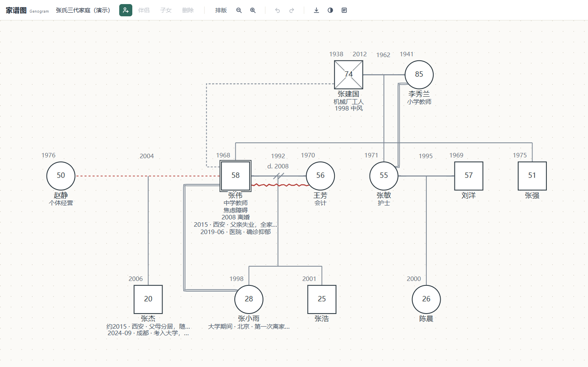
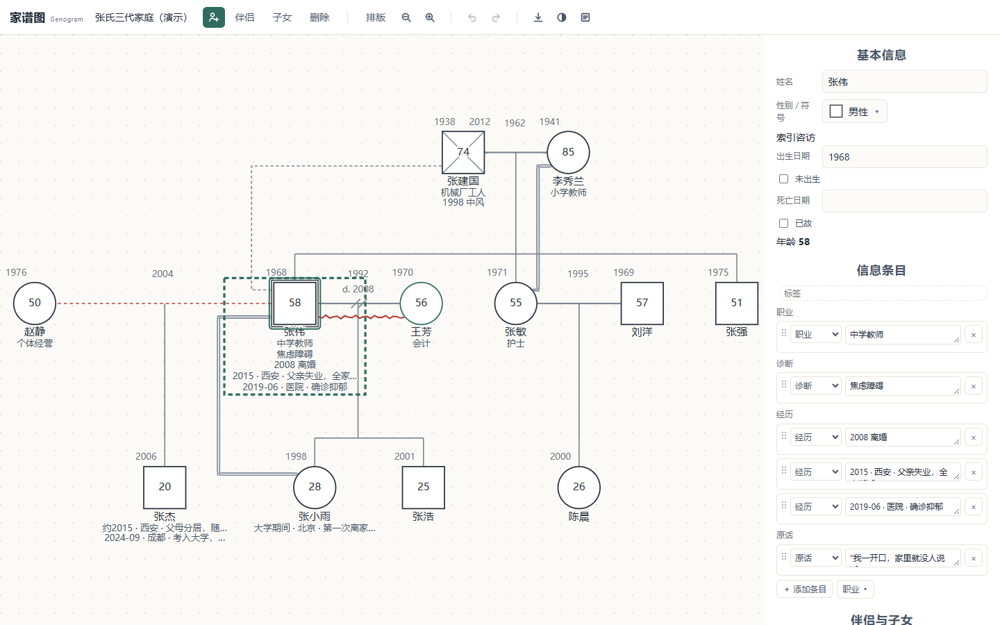
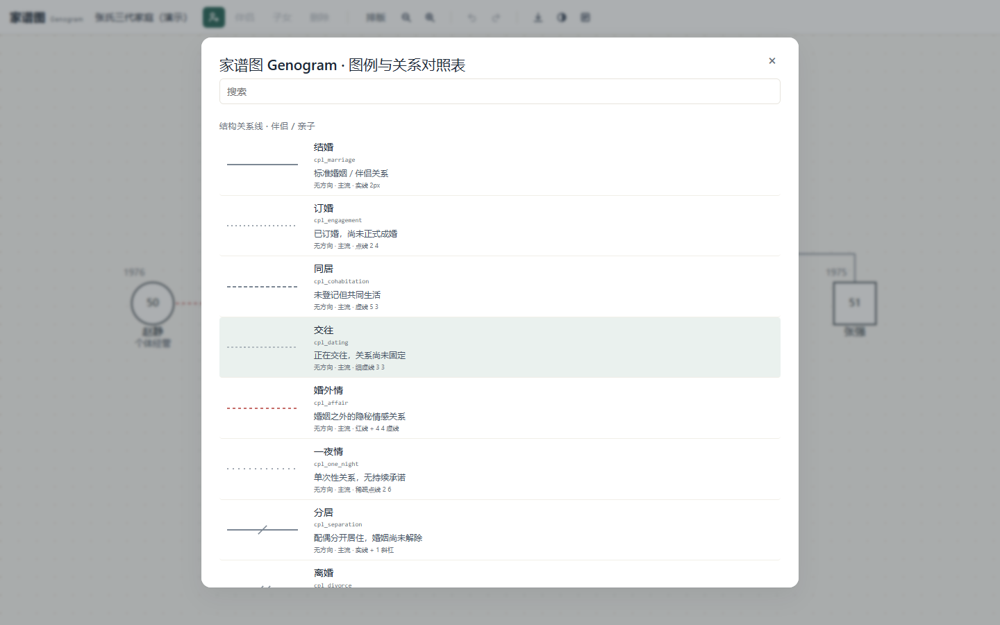

<!--
  文件用途：本仓库的说明文档（中文为主，文末附英文摘要）。
  面向使用者与二次开发者：说明这是什么工具、怎么下载与使用、功能范围、数据结构、署名规则与历史版本。
  主下载区只放最新版本；旧版本集中放在文末「历史版本」一节。
-->
# 心理咨询家谱图编辑器 · Counseling Genogram Editor

一张**单文件、零依赖、完全离线**的家谱图（genogram）编辑器：把 `index.html` 拖进浏览器就能画心理咨询里用的三代家谱图，人物符号、结构关系、情感关系、排版、导出全部现成。

- **零安装**：一个 HTML 文件，无 CDN、无 npm、无构建步骤，不联网
- **零外链**：运行时不发起任何网络请求，界面与图形全部本地渲染
- **数据留在本机**：只用浏览器 localStorage 自动存档，作者不收集任何数据
- **MIT 开源**：可自由使用、修改、商用。**个人使用不需要署名，界面与导出物上也不会出现任何署名；商用必须保留版权声明并署名**，见 [LICENSE](LICENSE)、[LICENSE.zh-CN.md](LICENSE.zh-CN.md) 与 [NOTICE.md](NOTICE.md)

> 本工具是记录与沟通用的绘图辅助，不提供诊断、评估或治疗建议。用于临床记录时请遵守所在机构的伦理规范与来访者知情同意要求。

## 下载（只放最新版）

**最新版本：v1.3.0（2026-11-09）**

| 下载 | 说明 |
| --- | --- |
| [index.html](https://github.com/baiguiyang666-oss/counseling-genogram/releases/download/v1.3.0/index.html) | 主程序，下载后双击即可打开 |
| [v1.3.0 发布页](https://github.com/baiguiyang666-oss/counseling-genogram/releases/tag/v1.3.0) | 版本说明与 Release 附件 |

> 旧版本（v1.2.0 及更早）不再占用主下载位置，统一列在文末[历史版本](#历史版本)。旧 Release 与下载链接永久有效，不会被删除。

## 为什么又造一个家谱图工具

市面上常见的家族关系 / 家谱类工具，底层多半是**树**：一个节点向下分出子节点，每条边只有「上 → 下」的分支语义，没有「两条线先合成一条、再向下分开」的表达能力。

而心理咨询里用的家谱图，核心结构恰恰是后者：**两个人的伴侣关系本身就是一条独立的关系线（union），子女通过亲子边挂在这条关系线上，而不是挂在某一位家长身上**。由此才可能出现这样的真实情形——同一个人有多段伴侣关系（结婚、同居、婚外情、分居、离异、再婚……），每段关系各自带自己的子女，而子女的「父 / 母」指向的是那段关系，不是某个具体的人。它不是树，而是带「合流」的有向图。这一点直接决定了三件事：

- **数据层**：伴侣关系是一等实体。备份 JSON 里 `unions` 与 `persons` 平级，`parentLinks` 存的是 `{ child, union }` 而不是 `{ child, parent }`；删除一段伴侣关系时，挂在它上面的亲子边会一并清理，不留悬空引用。
- **排版层**：不能套用「父节点居中于子节点」的树形分层。这里的规则是父母中心距等于子女首末跨度的两端对齐（左侧父母对齐第一个孩子、右侧父母对齐最后一个孩子），中继竖线落在伴侣线中点，同层兄弟姐妹共用一条横线；任意两个人物符号边到边净距 ≥ 70px，连线只走水平 / 垂直折线（离婚线中段的 `//` 是标记图元，不是布线）；增删人物、增删关系、折叠或展开之后都会重新求解，不需要手工拖线对齐。
- **表达层**：关系语义直接画进线条本身——结构关系 16 种状态（另加「单亲」）、亲子关系 8 种、情感关系 39 类，粗细、虚实与线中图标（`//`、`⊘`、`▯▯`、`×`、`○`、`◇`、箭头等）就是含义，不靠文字标注去解释。

另外把咨询实务里常用的几件事做进了同一个文件：索引咨访用双轮廓标出（全图仅一位），每位人物可挂出生 / 死亡日期与职业、重要事件经历（时间 / 地点 / 事件），年龄按出生日期实时计算；导出 PNG 1x / 2x、PDF 两页（第 1 页图形、第 2 页逐人逐关系的文字明细）、单文件 HTML、数据图例与 JSON 备份。

最后是交付形态：**单文件、零依赖、不联网**。来访者信息是高度敏感的数据，「把 HTML 拷到工作电脑或 U 盘里，双击就能用，不上传任何内容」在临床场景中比「功能更多但需要登录云端」更实际；也正因为只有一个文件，它可以被归档、被审计、被长期保存。

## 截图

> 三张截图均于 2026-11-09 用 v1.3.0 当前构建重新生成（1440×900），字号、配色、工具栏、线型接点与现在的界面一致。


*首次打开载入的三代示例（12 人、4 组伴侣关系、7 条亲子关系、4 条情感线），符号内的数字是依出生年份实时计算的年龄；已故者打叉并显示寿年。*


*点选人物后右侧展开属性面板：姓名、性别、符号、生卒、孕产状态，以及可增删改的备注条目与事件列表；被选中的索引咨访用双轮廓标出。*


*图例共 63 行真实线型，可搜索、可点击某一行直接应用到当前选中的关系——看到的就是画出来会得到的效果。*

## 功能

### 人物符号

- 8 种基础符号：男性（方）、女性（圆）、性别未明（菱形）、非二元（拱形）、间性、跨性别男、跨性别女、宠物（点线菱形）
- 叠加标记：**索引咨访**（双轮廓，全图仅一个）、**已故**（符号内打叉；符号中心有文字时自动改为四角短线）、**孕产**（怀孕 = 符号内正三角，流产 = 符号内实心圆点）
- 符号中心自动显示年龄：健在按出生日期实时计算，已故显示寿年，未出生改显「孕N月」（精确的「孕 N 个月（约 M 周）」在面板与导出明细里）；出生日期缺失时留空

### 关系

| 类别 | 数量 | 覆盖 |
| --- | --- | --- |
| 伴侣 / 结构关系 | 16 种状态（另加「单亲」） | 结婚、订婚、同居、交往、婚外情、一夜情、分居、离婚、断绝、再婚、丧偶、婚姻无效、强迫/性侵关系、血亲婚配、离婚·A 方监护、离婚·B 方监护 |
| 亲子关系 | 8 种 | 亲生、收养、寄养、继子女、监护（G）、代孕（S）、精子捐赠（SD）、卵子捐赠（ED） |
| 情感关系 | 39 种 | 亲密、融合、疏远、冲突、敌对、断绝、断裂修复、关注、照顾者、控制、操纵、嫉妒、忽视、暴力、虐待（未分类/身体/情感/性）、爱、热恋、崇拜、痴迷、友谊、挚友、不信任、从未见面、仇恨 等 |

- 线中图标（`//`、`⊘`、`▯▯`、`×`、`○`、`◇`、箭头等）全部由 SVG 图元现场绘制，不依赖任何字体或图片
- 同一对人物之间可以同时挂多条情感线；情感线有方向（`from → to`）
- **图例 63 行**：人物符号、结构线型、亲子线型、情感线型逐条列出，含临床含义、线宽、虚实说明

### 排版

- 同层兄弟姐妹共用一条横线；父母关系线中心与子女首末跨度两端对齐
- 中继竖线居中，**全部正交布线，不出现斜线**
- **接点贴合符号外缘**：伴侣线、亲子竖线、情感线与锯齿线的端点按符号实际轮廓投影，方块、圆圈、菱形、双轮廓索引咨访各自取到自己的外缘，不压线、不留缝
- 两个人物符号边到边净距 ≥ **70px**，文字块之间 ≥ 28px，文字不会被线穿过
- 代间净距按实际文字占位自适应：只有净距不足 **20px** 的那一对相邻代才补差，其余代保持紧凑
- 拖动人物做微调后，连线自动贴合重排；「排版」一键复位
- 支持一对多子女、多段婚姻、跨代嵌套；子树可**折叠 / 展开**，画布实时自适应
- 拖动吸附行为全代 + 上下各 2 条空白吸附带：三代示例共 7 条吸附行，拖到空白代带也能吸住对齐
- 视口 ≤ 760px 时面板改为底部抽屉、工具栏单行横向滚动；「只看选中分支」改为手动触发（画布右键菜单），首次打开不再自动聚焦分支

### 记录与界面

- 每人可挂多条备注：职业、诊断、重大事件、标签、原话、备注；类别可自行新增 / 删除（新增输入框在下拉顶部），面板按类别聚合，条目可拖拽排序
- 标签输入按微信的方式：中英文标点与换行都会切成标签，标签以 chip 展示、点 chip 上的 × 即可删除并立即持久化；输入框为空时按退格，最后一个标签回到输入框继续编辑
- 每人可挂多条「重要事件 / 经历」：时间、地点、事件，可增删改
- 撤销 / 重做、5 套主题色卡（符号填充与画布底色可手动覆盖）
- localStorage 自动存档：文档、视图、主题分三个键保存，刷新或关掉浏览器再打开数据还在
- 键盘可达：Tab 可聚焦到人物符号，Enter / 空格 即选中
- 触屏三态互斥：短按出详情页；按住 1000ms 不动、松手只出工具栏动作条；拖动全程（含松手后）都不弹任何浮层

### 导出

| 格式 | 说明 |
| --- | --- |
| PNG 图片 | 1x / 2x（默认 2x），与预览同一份 SVG 栅格化 |
| PDF / 打印 | 第 1 页为关系图；「附明细页」开关打开时追加第 2 页，逐人 + 逐关系文字明细。关系图固定单页，按 A4 横向自动缩放 |
| HTML 单文件 | 同上两页的静态文档（明细页可关闭），带主题样式，可直接分享或归档 |
| 数据图例 | 一份独立的线型对照表 HTML，适合打印贴在案头 |
| JSON 备份 / 导入 | 全量数据，可跨设备迁移，也可导入旧备份 |

导出面板里可以预览第 2 页明细；除打印外，导出前都会先弹出预览，**预览即所得**：预览与最终文件走同一份 SVG 序列化路径。

## 怎么用

1. 从上面[「下载」](#下载只放最新版)一节拿到最新版 `index.html`（就一个文件）
2. **双击打开**，或在浏览器里把文件**拖进窗口**
3. 首次打开会载入一张三代示例图，可以直接在它上面改；想从零开始就点「导出 → 新建空白图」（会二次确认）

不需要安装、不需要联网、不需要跑任何命令。想放到内网共享也只要把这个文件放上去，别人下载即用。

## 操作与快捷键

| 快捷键 | 作用 |
| --- | --- |
| `Ctrl+Z` | 撤销 |
| `Ctrl+Shift+Z` / `Ctrl+Y` | 重做 |
| `Ctrl+S` | 导出 JSON 备份 |
| `Del` / `Backspace` | 删除选中的人物 / 关系 |
| `F` | 适应屏幕 |
| `0` | 缩放到 100% |
| `+` / `-` | 放大 / 缩小（每步 1.15 倍） |
| `?` 或 `Shift+/` | 打开图例与快捷键面板 |
| `Esc` | 关闭弹层 / 取消选中 / 取消正在建立的情感线 |
| `Enter` | 选中人物时跳到姓名输入框；Tab 聚焦符号后按 Enter 等于选中 |
| `空格` | 选中人物时折叠 / 展开其子树 |

鼠标与面板：

- **滚轮缩放**（以光标位置为中心），**空白处拖动平移**
- 拖动人物符号可微调位置，再用「排版」复位
- 工具栏：`＋ 人物`、`伴侣`、`子女`、`删除`、`排版`、缩放、`撤销`、`重做`、`导出`、`主题`、`图例`
- 建立情感线：选中人物后点面板里的「＋ 新建情感线」，再点另一个目标人物（按 `Esc` 可取消）
- 图例面板里点任意一行，会把它应用到当前选中的那条关系上

触屏：

- 短按（位移 ≤ 6px、时长 < 1000ms）＝ 选中并展开详情页
- 按住不动 1000ms 后松手 ＝ 只出横向动作条，不出详情页
- 拖动（位移超过 6px）＝ 人物跟手 + 代带磁吸，全程与松手后都不弹浮层

## 数据结构与备份

JSON 备份是一个纯文本对象，可直接读、可手工改、可进版本库（注意：若含来访者信息，请自行脱敏后再外发）。

```jsonc
{
  "schemaVersion": 1,
  "meta": { "title": "家谱图标题", "createdAt": "ISO 时间", "updatedAt": "ISO 时间" },
  "persons": [
    {
      "id": "p1",
      "name": "姓名",
      "gender": "male",              // male | female | other | unknown
      "symbol": "",                  // 可选：覆盖默认符号，如 person_nonbinary
      "deceased": false,
      "birthYear": 1968, "birthDate": "", // birthDate 为 YYYY-MM-DD，优先于 birthYear
      "deathYear": null, "deathDate": "",
      "pregnancy": null,             // null | pregnant | miscarriage
      "collapsed": false,            // 子树是否折叠
      "offset": { "x": 0, "y": 0 },  // 手动微调位移，可用「排版」清零
      "notes":  [ { "id": "n1", "type": "occupation", "label": "职业", "value": "中学教师" } ],
      "events": [ { "id": "e1", "time": "2019-06", "place": "医院", "text": "确诊抑郁" } ]
    }
  ],
  "unions": [ { "id": "u1", "a": "p1", "b": "p2", "status": "married",
                "since": 1962, "until": null, "order": 0, "note": "" } ],
  "parentLinks": [ { "id": "l1", "child": "p3", "union": "u1",
                     "kind": "biological", "order": 0, "primary": true } ],
  "emotionalLinks": [ { "id": "e1", "from": "p3", "to": "p6", "type": "conflict", "note": "" } ],
  "probandId": "p3",
  "view": { "x": 0, "y": 0, "scale": 1 }
}
```

要点：

- `probandId` 是标量，因此**一张图只有一个「索引咨访」**
- `unions[].status` 取 16 种结构状态之一；`parentLinks[].kind` 取 8 种亲子类型之一；`emotionalLinks[].type` 取 39 种情感线型之一
- `notes[].type`：`occupation` 职业、`diagnosis` 诊断、`event` 重大事件、`tag` 标签、`quote` 原话、`note` 备注
- 导入时会自动规范化与迁移：补齐缺省字段、丢弃重复 `id`、清理非法日期、把未知枚举回退到默认值
- 浏览器里存三个键：`genogram.v1.doc`（文档）、`genogram.v1.view`（视图）、`genogram.v1.theme`（主题）

## 浏览器兼容性

| 浏览器 | 状态 |
| --- | --- |
| Chrome / Edge 100+ | 完整支持（推荐） |
| Firefox 100+ | 完整支持 |
| Safari 15+ | 基本可用；`file://` 下 localStorage 可能被限制，建议改用 Chrome/Edge 或本地静态服务 |

依赖的都是标准能力：SVG、Canvas `measureText`、`localStorage`、`DOMPoint`。没有 polyfill，没有第三方库。

## 关于「单文件零依赖」

- 全部 HTML / CSS / JS / SVG 都在 `index.html` 里，约 370 KB（381,367 字节），**没有第二个文件**
- 没有 CDN、没有 `import`、没有 `fetch`、没有 Web Font、没有外部图片；源码里搜不到任何外链
- 源码中 SVG 命名空间常量写作 `'http' + '://www.w3.org/2000/svg'`（拼接而非字面量）：这是为了让静态检查脚本不把这串字符误判成「外部链接」，运行时行为与字面量完全一致
- 因此断网、内网、离线 U 盘环境都能用；也不存在「某个依赖包更新把页面搞坏」的风险

## 用 AI 复刻这个工具

[`docs/genogram-ai-prompt.md`](docs/genogram-ai-prompt.md) 是一份**可以直接整段粘给任意 AI** 的开发提示词：别人拿到它，用 AI 就能从零复刻出一个结构、行为与本项目等价的家谱图工具。

- **前半是需求规格**：硬约束、符号体系（人物、伴侣 16 型、亲子 8 型、情感 39 型）、数据模型与一致性约束、排版与布线（含全部数值阈值）、拖动、交互、输入设备、信息条目、导出、主题与持久化
- **后半是验收清单**：76 项可勾选检查，每项都写了「怎么测」与「什么算通过」，可以直接当交付验收表用
- **数值与当前实现一致**：符号 56px、相邻净距 70px、有连线直连 84px、代间 96px、代间净距下限 20px、接点贴符号外缘、求解收敛 0.02px / 最多 24 轮、刷新后坐标逐位相同
- **写成需求而不是源码解说**：正文不出现本仓库的文件名、路径与行号（仅文件头的用途注释除外），换一个模型、换一种实现方式也能照着做

三种用法：想改出自己的一版但不想先读完整份代码；想给团队 / 机构定一套家谱图工具的功能口径；想验证某个模型能不能一次生成可用的单文件应用。

## 符号体系来源

图形语言沿用 **McGoldrick《Genograms》等公开文献中的家谱图传统**（家族治疗与家庭医学领域通用的符号约定）：方块=男、圆=女、叉线=已故、双轮廓=索引咨访、线型区分婚姻/离婚/情感性质等。

- 本项目是**独立自绘的 SVG 实现**，不包含、不复制任何商业家谱图软件的代码、素材或模板，与任何商业软件厂商无关
- 少数线型（如「矛盾」正弦波浪、「照顾者」楔形箭头）在传统体系中并无统一画法，本项目按讲义常见变体实现，并在图例里标为**「非标准扩展」**，临床使用请以所在机构的规范为准
- 图例中每一条线型都标注了线宽与虚实结构，便于与纸笔家谱图对照

## 已知限制

- **单文档**：一个浏览器只维护一张图（localStorage 单键）。多个案例请各自导出 JSON / HTML 保存；「新建空白图」会清空当前内容（有确认弹窗）
- **婚外情支的中继偏移**：婚外情支线在个别紧凑布局下，中继竖线会有小幅偏移，不影响符号与文字的可读性，但视觉上不如标准婚姻支严格居中
- **小屏默认看全图**：视口 ≤ 760px 时面板变为底部抽屉，画布高度变小；想看某一支可手动选「只看选中分支」，其余分支需要拖动查看
- **PDF 走浏览器打印通道**：页边距、页眉页脚、分页由浏览器决定，不同浏览器字体渲染也略有差异；想固定版式建议用「HTML 单文件」导出
- **PNG 栅格化上限**：导出宽度或高度超过 8192px 时会自动降采样，超大图会损失一些细节
- **无云同步 / 无协作**：数据不出本机是优点，也意味着换设备要手动迁移 JSON

## 版本与更新

每次更新的流程只有四步：修改 `index.html` → 提交 → 递增 tag（`v1.3.0` / `v1.4.0` …）→ 发新 Release。**最新版本只出现在顶部[「下载」](#下载只放最新版)一节**；旧版本的 tag、Release 与下载链接永久有效，统一列在下方[「历史版本」](#历史版本)，不会因为新版本发布而失效。

### v1.3.0 更新要点

- **结构线接点贴合符号外缘**：伴侣线、亲子竖线、情感线、锯齿线的端点改为按符号实际轮廓投影，方块 / 圆圈 / 菱形 / 双轮廓各自算到自己的外缘（实测端点误差在 0.11px 以内），不再出现线头压在符号上或差一截的情况
- **触屏三态互斥**：短按出详情页；按住 1000ms 不动、松手只出工具栏动作条；拖动全程不弹任何浮层，松手后也一样
- **标签输入重做**：中英文标点与换行都切成标签，标签以 chip 展示、点 × 删除并立即持久化；输入框为空时按退格，最后一个标签回到输入框可继续编辑，与微信的标签输入一致
- **排版增强**：吸附行从 3 代扩展到「实际代数 + 上下各 2 条空带」（三代示例共 7 条），拖到空白代带也能吸住；代间净距按实际文字占位自适应，只有不足 20px 的那一对相邻代才补差
- **窄屏与孕产显示**：窄屏下婚姻结束日期换行不再溢出；未出生孩子按预产期显示「孕 N 个月（约 M 周）」
- **交互细节**：备注类别下拉里「＋ 新增类别」的输入框移到下拉顶部，新增类别不用先滚到底
- **兼容性**：数据模型、导出格式、快捷键、三个 localStorage 键均与 v1.2.0 一致，可直接打开 v1.2.0 及更早版本的 JSON 备份

## 历史版本

主下载区只放最新版；下面这些版本已从主位撤下，Release 页与下载链接永久保留。

| 版本 | 日期 | 说明 | Release |
| --- | --- | --- | --- |
| v1.2.0 | 2026-11-08 | 视觉与键盘导航：14px 字号、19 个颜色令牌、方向键分层导航 | [v1.2.0 发布页](https://github.com/baiguiyang666-oss/counseling-genogram/releases/tag/v1.2.0) |
| v1.1.0 | 2026-11-08 | 交互与编辑重构：性别符号合并、完整日期、信息条目、跨代吸附、手柄 / 触屏、导出单页 | [v1.1.0 发布页](https://github.com/baiguiyang666-oss/counseling-genogram/releases/tag/v1.1.0) |
| v1.0.0 | 2026-11-05 | 首个发布版：单文件心理咨询家谱图编辑器 | [v1.0.0 发布页](https://github.com/baiguiyang666-oss/counseling-genogram/releases/tag/v1.0.0) |

### v1.2.0 更新要点（存档）

- **字号与行高整体上调**：全局 13.5px 统一改为 14px，面板字段、分区标题、空状态与提示文字的字号层级重新梳理，长文本与姓名在面板里更易读
- **统一颜色令牌**：新增 19 个主题变量——面板二级底色 `--panel-2`、悬停 / 按下（`--surface-hover` / `--surface-pressed`）、开关（`--switch-*`）、预览浮层（`--peek-*` / `--preview-bg`）、行内编辑框（`--gx-pick` / `--gx-neg`）、滚动条与提示条等；工具栏、面板、弹层共用同一套取值，并移除了旧的 `--accent-ring`
- **视觉细节收口**：预览浮层、开关控件、行内编辑框、通用按钮的描边 / 圆角 / 阴影统一到新的色板
- **方向键分层导航修复**：新增工具栏 / 面板 / 画布之间的分层导航（`layerNav` / `enterPanelNav`），方向键与手柄只在当前层内移动，走到层边界不再跳到另一区
- **本版以视觉与键盘导航为主**：数据模型、导出格式、快捷键与文件结构均与 v1.1.0 一致，v1.2.0 可直接打开 v1.1.0 的 JSON 备份与 localStorage 数据

### v1.1.0 更新要点（存档）

- **性别与符号合并为一个下拉**：选项直接带对应符号缩略图，覆盖男性、女性、性别未明、非二元、间性、跨性别男 / 女、宠物共 8 种
- **出生 / 死亡日期改为完整日期**：支持 `YYYY`、`YYYY-MM`、`YYYY-MM-DD` 三种精度，年 / 月 / 日三段自绘下拉，按真实日历裁剪当月天数（闰年 2 月 29 日可用）；填写死亡日期会自动置「已故」，清空则自动撤销
- **信息条目重构**：类别可新增、删除（删除时该类别的条目转入其他类别，不丢失）；面板按类别聚合；顶部标签输入按逗号、顿号、分号、换行切割成标签；长文本可全屏编辑；条目支持拖拽排序
- **跨代磁铁吸附**：拖动结束后，直系人物回到本代水平线（拖拽中可越过，但不能停在其他代）；非直系人物落在代带内则吸附最近代线，带外保持落点；吸附后可再次拖离
- **索引咨访面板按钮**：面板内可直接设为 / 取消索引咨访；全图唯一，已有人选时其他人的面板不显示该按钮
- **触屏长按动作条**：长按 550ms 弹出横向动作条，与右键菜单共用同一份命令表
- **遥控器 / 手柄**：方向键、摇杆与手柄按键按焦点分区在工具栏与面板间移动；长按返回键 900ms 删除当前焦点人物（可撤销）；肩键缩放
- **工具栏图标化**：新建、缩放、撤销、重做、导出、主题、图例改为内联 SVG 图标，其余操作保留文字按钮
- **导出**：「附明细页」开关控制 PDF 与单文件 HTML 是否带第 2 页明细，导出面板可预览第 2 页；PDF 关系图固定单页，按 A4 横向自动缩放

## 贡献与反馈

- 欢迎提 Issue 与 PR：请说明复现步骤、浏览器与版本、期望结果与实际结果；涉及排版的改动请附前后截图
- 每个文件是干什么的，见 [docs/README.md](docs/README.md)（含 docs 下三张截图的用途登记）
- 代码全部在一个文件里，文件头注释块写明版权与许可，其余分区注释标在各自逻辑上方（排版、吸附、触屏、导出等）
- 请保持这几个硬约束：**单文件、零依赖、无 CDN、无构建步骤、不改变既有行为**
- 提交前请自测：控制台 0 报错、结构线无斜线、导出的 PNG / HTML 能正常打开、刷新后数据还在

## 许可证与署名

本项目以 **MIT License** 发布，版权归 **白贵阳**（2025-2026）。署名规则分两件事，互不冲突：

### 1. 本项目自身怎么署名

- **个人使用（零署名）**：界面、导出 PNG / PDF / HTML、打印页上**一律不出现**作者名、项目名、`MIT`、`License`、`Copyright`、`©` 等字样——使用者完全看不出这是谁做的；个人自己用、在机构内部用，都不需要额外署名。
- **商业使用（必须署名）**：保留 `LICENSE` 全文与版权声明（`Copyright (c) 2025-2026 白贵阳`），并在网站、产品界面、文档或交付物的**显著位置**署名、附本仓库链接；推荐写法见 [NOTICE.md](NOTICE.md)。
- 「界面零署名」不等于「放弃署名」：署名与许可写在 [`index.html` 顶部注释](index.html)、[LICENSE](LICENSE)、[LICENSE.zh-CN.md](LICENSE.zh-CN.md) 与 [NOTICE.md](NOTICE.md) 里，随代码一起分发。

### 2. 用 `docs/genogram-ai-prompt.md` 生成的新工具怎么署名

[`docs/genogram-ai-prompt.md`](docs/genogram-ai-prompt.md) 是一份**开发提示词**，不是本项目代码的再分发。照它让 AI 生成的新工具，版权归生成者自己，不强制套用本仓库的署名内容。但这份提示词要求生成的工具遵守同一口径：

- 生成的工具**界面与全部导出产物**不显示任何署名（个人使用看不出作者）；
- 生成的工具**必须在源码顶部注释里写清作者与许可**，并在 `LICENSE` / `NOTICE` 里给出可执行的商用署名方式；
- 验收口径：界面与导出物中署名类字样命中数为 **0**，源码注释里**必须**能读到"商用须署名"的要求。

如果你把生成的工具再对外分发，建议在它的文档里注明「需求口径参考 `counseling-genogram` 的 `docs/genogram-ai-prompt.md`」。

### 商用时的最小署名写法

> 家谱图由「心理咨询家谱图编辑器」绘制 · © 2025-2026 白贵阳 · MIT License
> https://github.com/baiguiyang666-oss/counseling-genogram

更多格式（网页页脚、文档脚注、图片 alt、打包分发）见 [NOTICE.md](NOTICE.md)。

---

## English Summary

A **single-file, zero-dependency, fully offline** editor for psychological genograms. Open `index.html` in any modern browser — no install, no build, no network calls.

**Why another genogram tool**: most online family-tree tools are trees — a node branches downward, but two lines can never merge into one and then split again. A clinical genogram needs exactly that: the couple relationship (union) is a first-class entity, and each child's parent link points at the union rather than at a person, so one person can carry several unions (marriage, cohabitation, affair, separation, divorce, remarriage), each with its own children. The underlying model is a directed graph with merges, not a tree. That drives the layout (the parents' centre distance equals the span from the first to the last child, the relay line sits on the union's midpoint, siblings share one horizontal line, ≥70px symbol clearance, orthogonal routing with no diagonal edges, automatic re-layout after any edit or collapse) and the notation (16 couple statuses, 8 parent–child types, 39 emotional line types, where stroke widths, dash patterns and mid-line glyphs carry the meaning). It ships as one offline HTML file because client data is sensitive and clinical work often happens on machines that should not upload anything.

**Features**: 8 person symbols plus overlays for index client, deceased, pregnancy/miscarriage, and auto-computed age (unborn children show gestational months/weeks); 16 couple/structure statuses, 8 parent–child types and 39 emotional relationship line types, all drawn as inline SVG; sibling alignment, centre-aligned couple lines, orthogonal routing with no diagonal edges, ≥70px symbol clearance, edge terminals projected onto each symbol's actual outline, collapsible branches and drag-to-reposition with auto re-layout; per-person notes and timed life events, with WeChat-style tag chips that split on any Chinese or English punctuation; a searchable 63-row symbol/line legend; export to PNG (1x/2x), two-page PDF/print, self-contained HTML, or JSON backup/import, all with live preview; undo/redo, five colour themes, and autosave to `localStorage`. On touch screens the three gestures are mutually exclusive: a short tap opens the detail panel, a 1000 ms press-and-release opens only the action bar, and dragging never raises any overlay.

**Licence**: MIT, © 2025-2026 白贵阳 (Bai Guiyang). Personal use is attribution-free by design — the UI, exported PNG / PDF / HTML and print pages show no author, project or licence marks. Commercial use **must** keep the copyright notice and the full licence text, and credit the author with a link to this repository (see [NOTICE.md](NOTICE.md)). The rule itself lives in the source header of `index.html`; a Chinese reference translation is in [LICENSE.zh-CN.md](LICENSE.zh-CN.md), while the English [LICENSE](LICENSE) prevails.

**Tools generated from `docs/genogram-ai-prompt.md`**: those belong to whoever generates them; the prompt only requires the same split — nothing visible in the UI or in any export, but the author/licence plus the commercial-attribution requirement written into the source comments and LICENSE / NOTICE.

**Disclaimer**: a drawing aid for documentation and communication — not a diagnostic or assessment tool.
